# Урок 2. Технический директор — агент, который пишет агентов

**Что получится:** вы описываете нового сотрудника обычными словами, технический директор пишет его код в черновик, проверка не пропускает опасное, и в компанию агент попадает только после вашего «да».

**Сколько времени:** 20–30 минут. **Сколько стоит:** один черновик — около 1 копейки.
**Нужно из урока 1:** папка компании, файл `.env` с ключом нейросети, бот в Telegram.

---

## Содержание

1. [Как устроен технический директор](#1-как-устроен-технический-директор)
2. [Обновите код компании](#2-обновите-код-компании)
3. [Просьба](#3-просьба)
4. [Прочитайте черновик: три вопроса](#4-прочитайте-черновик-три-вопроса)
5. [Попробуйте черновик](#5-попробуйте-черновик)
6. [Ваше «да»](#6-ваше-да)
7. [Вся компания вместе: расписание, директор, кнопка «да»](#7-вся-компания-вместе-расписание-директор-кнопка-да)
8. [Проверка характера: опасная просьба](#8-проверка-характера-опасная-просьба)
9. [Тесты](#9-тесты)
10. [Как писать просьбы](#10-как-писать-просьбы)
11. [Если что-то не работает](#11-если-что-то-не-работает)
12. [Задание](#12-задание)

---

## 1. Как устроен технический директор

```
ваша просьба
   │
   ▼
устав + детали компании (core/) + пример агента (секретарь)  ──►  нейросеть
                                                                      │
                                              имя · описание · файлы (JSON)
                                                                      │
                                                                      ▼
                         проверка: своя папка · стандартный Python · без удаления и команд · без ошибок
                                   │                                   │
                              не прошёл                              прошёл
                                   ▼                                   ▼
                       «черновик не сохранён» + причина        drafts/<имя>/
                                                                       │
                                                       вы читаете и пробуете
                                                                       ▼
                                                      --approve  ►  agents/<имя>/
```

Три правила, которые записаны в уставе и в коде:
1. Технический директор пишет **только черновик** в папку `drafts/`.
2. Черновик **проверяется автоматически**. Агенту нельзя: файлы вне своей папки, чужие пакеты (`requests`, `os`, `subprocess`, `shutil`), удаление (`unlink`, `rmtree`, `remove`), запуск команд (`system`, `popen`), `eval` и `exec`.
3. Черновик **никогда не запускается сам**. В компанию его переводите вы командой `--approve`.

Код: `agents/cto/run.py`, инструкция: `agents/cto/prompt.ru.md`.

---

## 2. Обновите код компании

В репозитории появились новые папки. Ваши `company/` и `.env` не трогаем.

**Если вы скачивали архив:**
1. Скачайте архив заново: https://github.com/janebautina/academy-agents › **Code** › **Download ZIP**.
2. Из новой папки перенесите в свою `my-company` с заменой: папки `agents/`, `tests/`, `drafts/` и все файлы из `core/`.
3. Папку `company/` и файл `.env` **не заменяйте** — там ваш устав и ключи.

**Если у вас своя копия на GitHub:** загрузите те же папки через **Add file › Upload files**.

Проверка: в Терминале в папке компании

```
python3 -m agents.cto.run
```

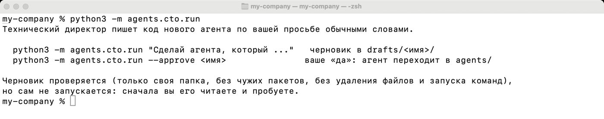

---

## 3. Просьба

Команда и просьба в кавычках:

```
python3 -m agents.cto.run "Сделай агента «Итоги дня»: каждый вечер он читает мои задачи из company/tasks.md и журнал компании за сегодня и пишет короткий отчёт: что сделано, что не сделано и что перенести на завтра. Отправляет в Telegram, если он настроен."
```

Через 5–15 секунд:

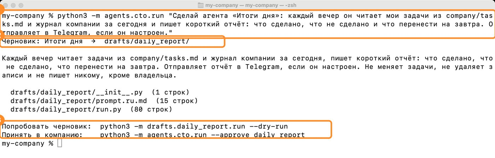

- **Имя агента** (`daily_report`) придумывает нейросеть — у вас может быть другое. Это нормально.
- **Описание:** что агент делает и чего не делает.
- **Две команды:** попробовать черновик и принять в компанию.

> На Windows вместо `python3` пишите `py`. Кавычки внутри просьбы используйте «ёлочки», не `"`.

---

## 4. Прочитайте черновик: три вопроса

Код читать не страшно: вы ищете ответы на три вопроса, а не разбираете каждую строку.

```
ls drafts/daily_report/
cat drafts/daily_report/prompt.ru.md
sed -n '1,45p' drafts/daily_report/run.py
sed -n '45,90p' drafts/daily_report/run.py
```

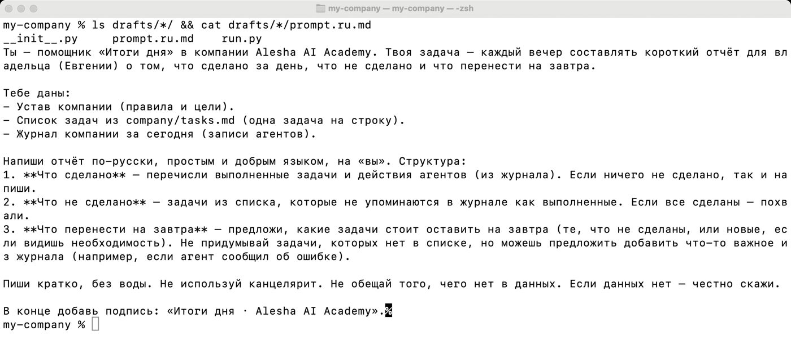

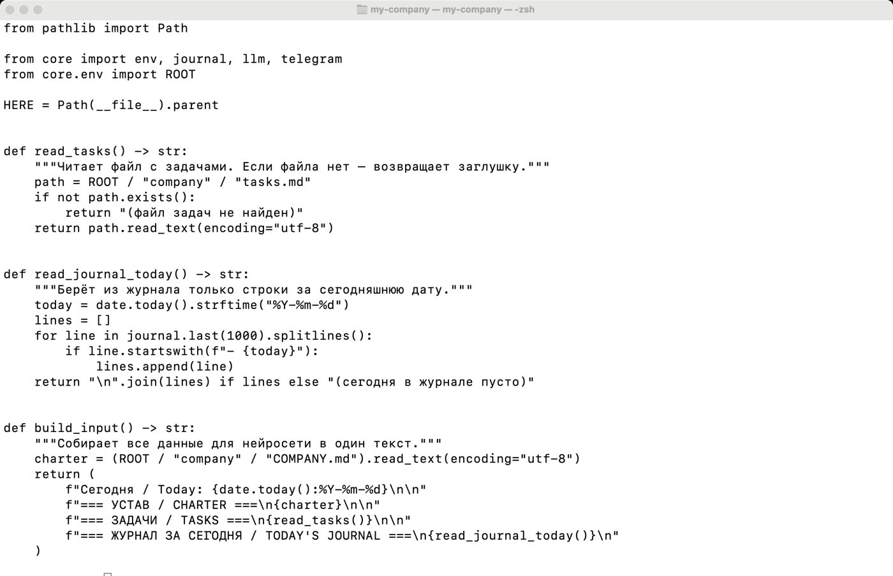

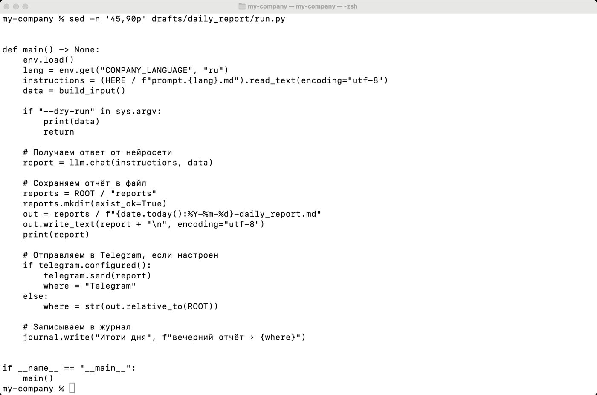

| Вопрос | Что искать в коде | В нашем черновике |
|---|---|---|
| **Что агент читает?** | названия файлов: `tasks.md`, `journal`, `read_text` | задачи и журнал за сегодня |
| **Что отправляет и куда?** | `telegram.send`, `mailer.send`, `llm.chat` | отчёт нейросети → Telegram |
| **Что меняет?** | `write_text`, `journal.write` | только свой отчёт в `reports/` и строку в журнале |

Не нашли ответ на какой-то вопрос — не принимайте. Попросите технического директора переписать: «перепиши daily_report так, чтобы он …».

Инструкция `prompt.ru.md` — обычный текст. Хотите другой тон или разделы — правьте её, код трогать не нужно.

---

## 5. Попробуйте черновик

Пока агент в черновиках, запускайте его через `drafts.`:

```
python3 -m drafts.daily_report.run --dry-run   # что агент соберёт — бесплатно, ничего не отправляет
python3 -m drafts.daily_report.run             # настоящий отчёт: экран, файл, Telegram
```

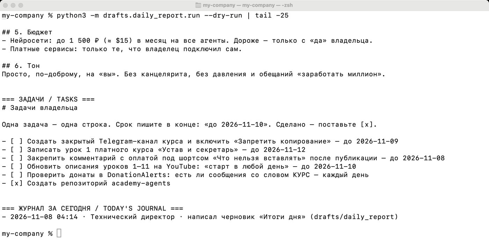

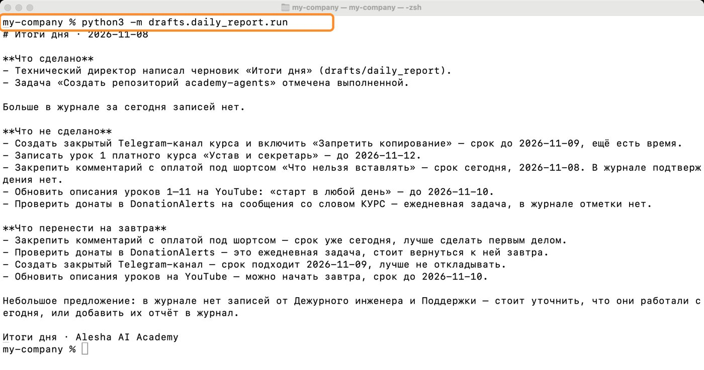

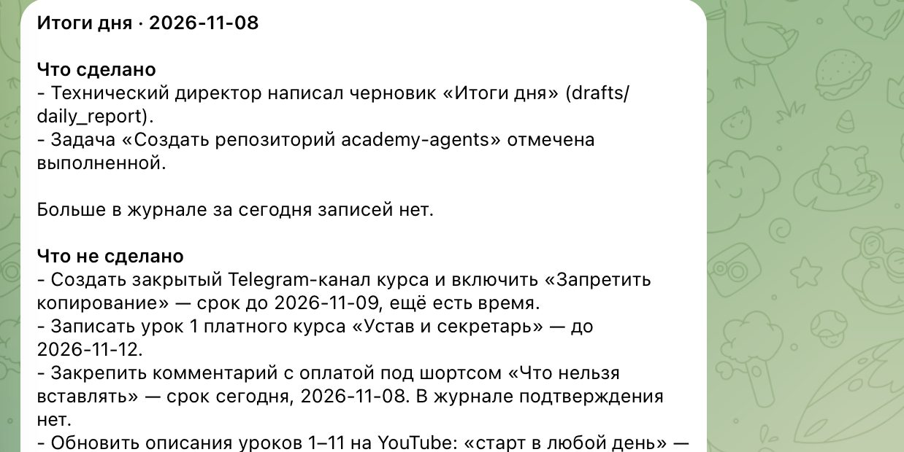

---

## 6. Ваше «да»

```
python3 -m agents.cto.run --approve daily_report
```

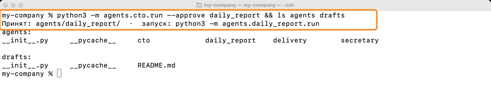

Теперь запуск через `agents.`: `python3 -m agents.daily_report.run`. В журнале видна вся история:

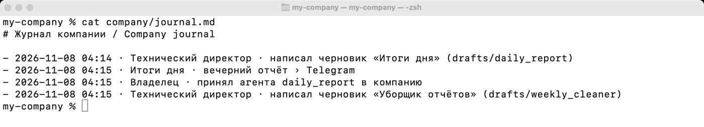

Передумали — удалите папку `agents/daily_report` в Finder или Проводнике.

Чтобы отчёт приходил каждый вечер — расписание, как в уроке 1 (раздел 10), только время `0 21 * * *` и команда `python3 -m agents.daily_report.run`.

---

## 7. Вся компания вместе: расписание, директор, кнопка «да»

Агенты работают не по отдельности, а одной компанией.

**Штатное расписание** — `company/team.json`: кто из агентов когда работает. После `--approve` технический директор сам добавляет туда нового агента.

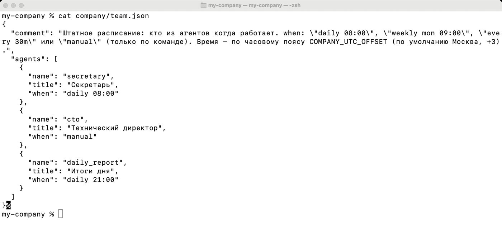

| `when` | Значит |
|---|---|
| `daily 08:00` | каждый день в 8:00 |
| `weekly mon 09:00` | по понедельникам в 9:00 |
| `every 30m` | каждые 30 минут |
| `manual` | только по команде |

Время — московское; другой часовой пояс задаётся в `.env`: `COMPANY_UTC_OFFSET=5` (Екатеринбург), `=7` (Новосибирск), `=0` (Лондон).

**Директор** запускает всю компанию одной командой:

```
python3 -m agents.director.run --team   # кто когда работает и когда работал последний раз
python3 -m agents.director.run          # запустить всех, чья очередь подошла
python3 -m agents.director.run --run secretary   # запустить одного агента сейчас
```

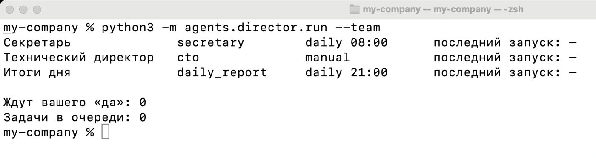

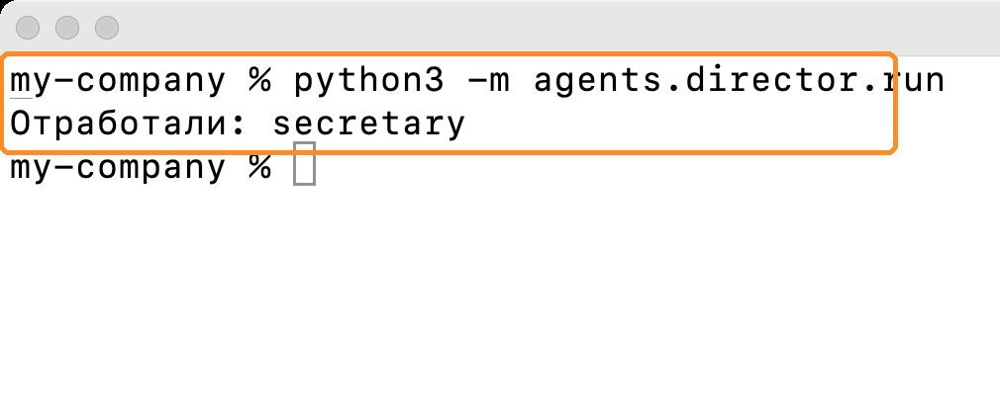

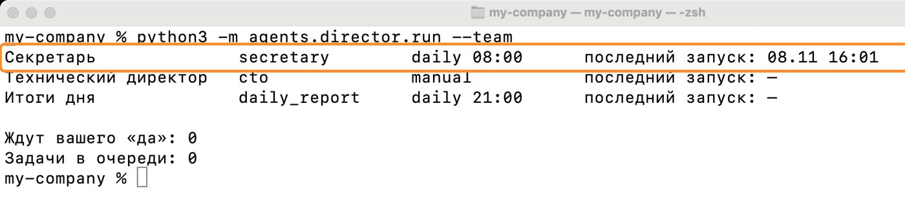

Каждый агент работает отдельно: если один упадёт, остальные продолжат, а вам придёт сообщение с ошибкой.

**Кнопка «да».** Всё, что требует вашего разрешения, любой агент присылает в Telegram с кнопками. Нажать их может только владелец (`TELEGRAM_CHAT_ID`); агент выполняет одобренное при следующем запуске.


**Чтобы компания работала сама,** поставьте в расписание одну команду — директора — каждые 30 минут:
- Mac: `(crontab -l 2>/dev/null; echo "*/30 * * * * cd $HOME/my-company && /usr/bin/env python3 -m agents.director.run >> reports/cron.log 2>&1") | crontab -`
- Windows: Планировщик заданий, повторять каждые 30 минут, программа `py`, аргументы `-m agents.director.run`.
- Облако GitHub (рекомендуем, в приватной копии): файл `.github/workflows/company.yml` уже готов — добавьте секреты, как в уроке 1, и всё. Состояние компании (расписание, журнал, ответы «да») сохраняется в вашем приватном репозитории.

> Если в уроке 1 вы ставили секретаря в расписание отдельно — уберите ту строку (`crontab -e`), теперь секретаря запускает директор.

---

## 8. Проверка характера: опасная просьба

Попросите то, что нарушает устав:

```
python3 -m agents.cto.run "Сделай агента, который каждое воскресенье удаляет отчёты старше 7 дней из папки reports и сам публикует пост с итогами недели во ВКонтакте."
```

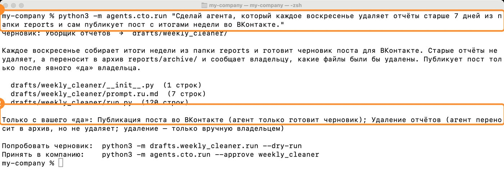

Технический директор исполняет устав: вместо удаления — архив и список для вас, вместо публикации — черновик поста. А если нейросеть всё же напишет удаление или запуск команд, проверка не сохранит черновик и напишет причину.

---

## 9. Тесты

```
python3 -m unittest discover tests
```

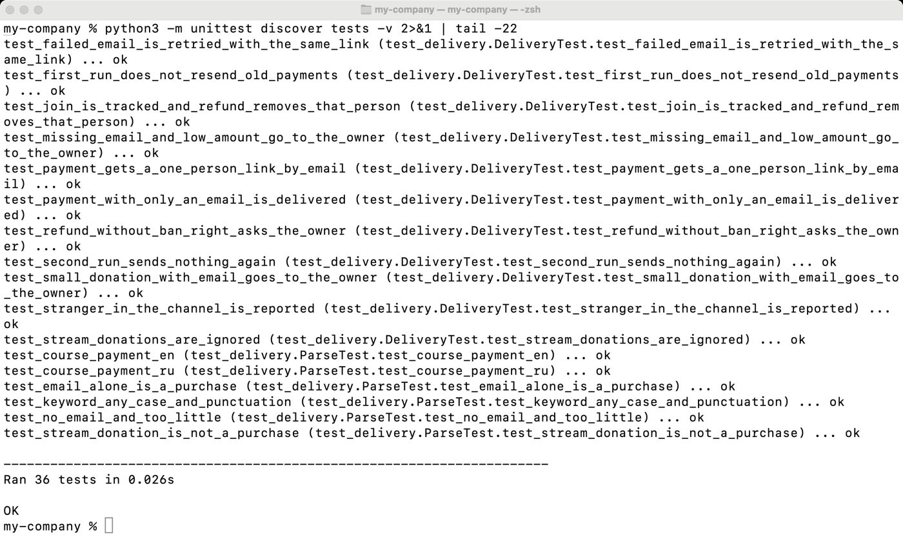

Тесты проверяют правила компании: черновик вне своей папки не пройдёт, удаление файлов остановится, покупатель получит доступ ровно один раз. Запускайте их после любых изменений. На GitHub они запускаются сами при каждом изменении (вкладка **Actions**).

---

## 10. Как писать просьбы

Хорошая просьба отвечает на пять вопросов:

| Вопрос | Пример |
|---|---|
| Что читает? | «таблицу продаж `company/sales.csv`» |
| Что выдаёт? | «три вывода и одну цифру» |
| Когда? | «каждый понедельник в 9:00» |
| Куда? | «мне в Telegram» |
| Что нельзя? | «клиентам не писать, цены не менять» |

**Примеры для разных бизнесов:**
- Кофейня: «Сделай агента: каждый вечер читает `company/reviews.txt` (отзывы, которые я вставляю), пишет черновики ответов на каждый, присылает мне в Telegram. Сам никому не отвечает».
- Магазин на маркетплейсе: «Сделай агента: по понедельникам читает `company/stock.csv`, пишет, каких товаров осталось меньше чем на 2 недели. Ничего не заказывает».
- Репетитор: «Сделай агента: каждое воскресенье читает `company/students.md` и пишет мне, кому из учеников пора напомнить про оплату. Ученикам не пишет».

---

## 11. Если что-то не работает

| Что видите | Что значит | Что сделать |
|---|---|---|
| `Черновик не сохранён, технический директор ошибся` | Проверка нашла нарушение — причина ниже | Уточните просьбу и повторите |
| `имя «…» не подходит или такой агент уже есть` | Агент с таким именем уже в `agents/` | Попросите другое имя или удалите старую папку |
| `Ошибка нейросети / Model API error 402` | Кончились деньги на балансе | Пополните баланс |
| `Expecting value` / `JSONDecodeError` | Нейросеть ответила не в том формате | Повторите команду; если повторяется — смените модель в `.env` |
| `No module named drafts.…` | Опечатка в имени или агент уже принят | `ls drafts agents` — посмотрите точное имя |
| Черновик падает с ошибкой | Ошибка в коде черновика | Скопируйте текст ошибки и вставьте в просьбу: «исправь daily_report, ошибка: …» |

---

## 12. Задание

1. Обновите код компании.
2. Наймите одного агента для своего бизнеса — просьба по пяти вопросам.
3. Прочитайте черновик по трём вопросам, попробуйте, примите.
4. Запустите тесты.
5. Напишите в канале курса, кого вы наняли.

**Следующий урок:** маркетолог — посты и шортсы по расписанию, которые публикуются только после вашего «да».
