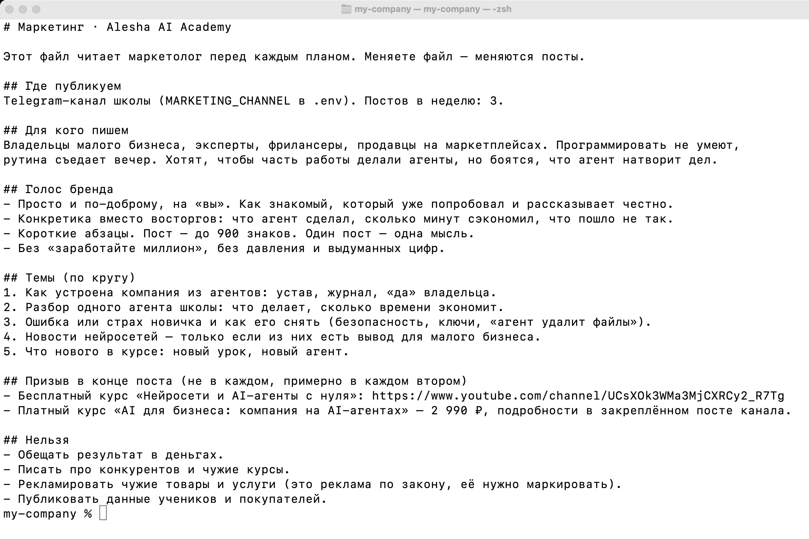
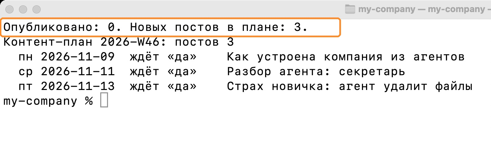
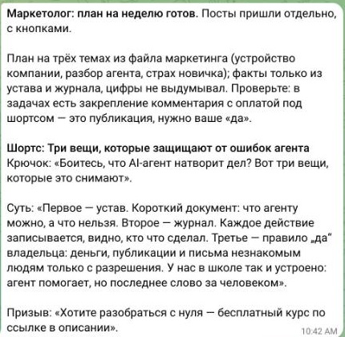
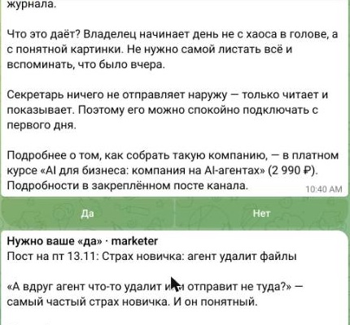
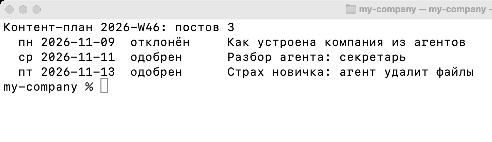
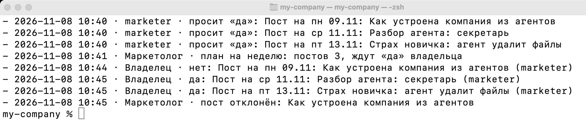
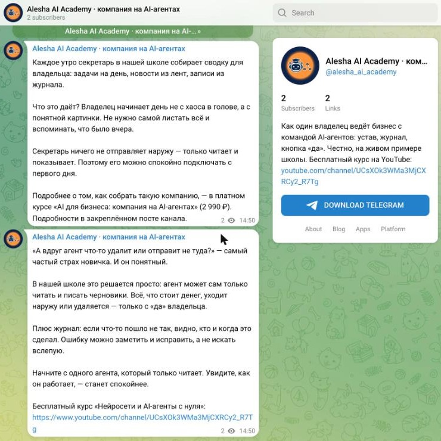
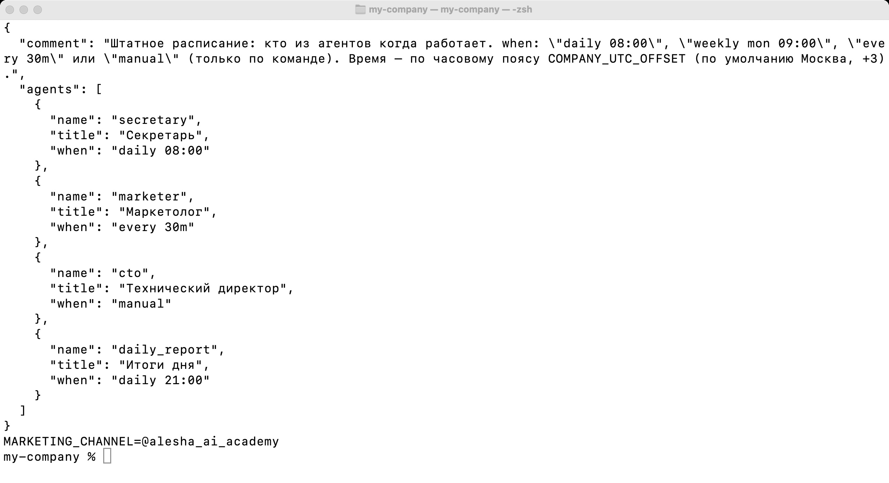
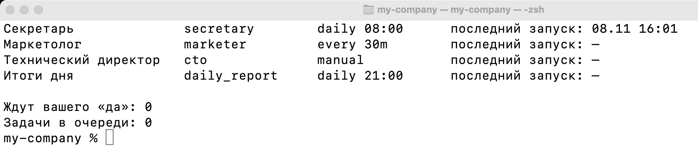
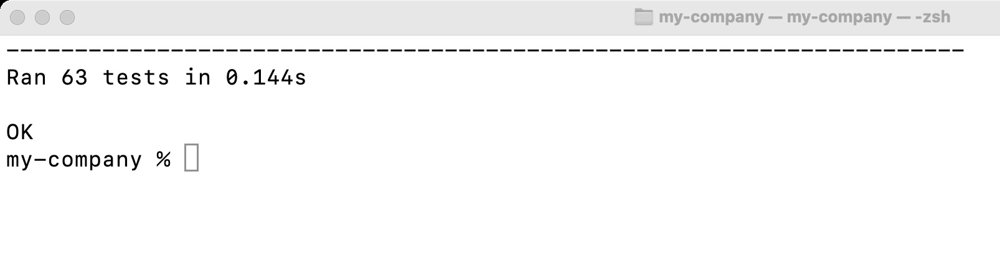

# Урок 3. Маркетолог — посты по плану и только с вашего «да»

**Что получится:** по понедельникам маркетолог пишет план постов на неделю, каждый пост присылает вам в Telegram с кнопками «Да» и «Нет», а одобренные посты сам публикует в ваш канал в их день.

**Сколько времени:** 20–30 минут. **Сколько стоит:** план на неделю — меньше рубля, проверки между планами бесплатны.
**Нужно из уроков 1–2:** папка компании, файл `.env` с ключом нейросети, бот в Telegram, директор в расписании.

---

## Содержание

1. [Как устроен маркетолог](#1-как-устроен-маркетолог)
2. [Обновите код компании](#2-обновите-код-компании)
3. [Канал и бот-администратор](#3-канал-и-бот-администратор)
4. [Файл маркетинга](#4-файл-маркетинга)
5. [План на неделю](#5-план-на-неделю)
6. [Ваше «да»](#6-ваше-да)
7. [Публикация](#7-публикация)
8. [Расписание](#8-расписание)
9. [Тесты](#9-тесты)
10. [Две ошибки живого запуска](#10-две-ошибки-живого-запуска)
11. [Если что-то не работает](#11-если-что-то-не-работает)
12. [Задание](#12-задание)

---

## 1. Как устроен маркетолог

```
понедельник, после 10:00
   │
   ▼
marketing.md + устав + задачи + ленты за неделю + журнал + отклонённые темы  ──►  нейросеть
                                                                                     │
                                                         3 поста · сценарий шортса · заметка
                                                                                     │
                                                                                     ▼
                                    каждый пост — вам в Telegram с кнопками «Да» / «Нет»
                                            │                                  │
                                           «Нет»                              «Да»
                                            ▼                                  ▼
                           тема запомнена, больше не предлагается     в свой день — в канал
```

Правила, которые записаны в уставе и в коде:
1. Маркетолог пишет **только черновики**. Ни один пост не выходит без вашего «Да».
2. Нажать кнопки может **только владелец** — чужие нажатия не считаются.
3. Одобренный пост выходит **один раз**: сразу после публикации он помечается «опубликован».
4. Шортсы маркетолог **не публикует**: это сценарий для вас.

Код: `agents/marketer/run.py`, инструкция: `agents/marketer/prompt.ru.md`, файл маркетинга: `company/marketing.md`.

---

## 2. Обновите код компании

Как в уроке 2:
1. Скачайте архив заново: https://github.com/janebautina/academy-agents › **Code** › **Download ZIP**.
2. Перенесите в свою `my-company` с заменой: папки `agents/`, `tests/` и все файлы из `core/`.
3. Если файла `company/marketing.md` у вас ещё нет — скопируйте и его.
4. Устав, задачи и файл `.env` **не заменяйте**.

Проверка:

```
ls agents
```

В списке появилась папка `marketer`.

---

## 3. Канал и бот-администратор

1. В Telegram: карандаш › **Создать канал**. Название, описание, фото.
2. Тип: **Публичный**, придумайте короткую ссылку (например, `t.me/my_shop_news`).
3. Откройте канал › **Управление каналом** › **Администраторы** › **Добавить администратора** › найдите своего бота.
4. Включите право **Публикация сообщений**. Остальные права можно выключить.
5. В файле `.env` добавьте строку:

```
MARKETING_CHANNEL=@my_shop_news
```

Для **закрытого** канала вместо имени нужен номер канала — он начинается с `-100`. Для маркетинга проще сделать канал публичным.

> Имя канала с «@» нужно только в `.env`. В текстах постов никаких «@имён»: в Telegram такая надпись — ссылка на аккаунт, и он может оказаться чужим. Ссылки в постах — только полностью, с `https://`.

---

## 4. Файл маркетинга

Откройте `company/marketing.md` и перепишите под свой бизнес. Маркетолог читает его перед каждым планом: меняете файл — меняются посты.



Разделы:
- **Где публикуем** и сколько постов в неделю.
- **Для кого пишем** — кто ваши клиенты и чего они боятся.
- **Голос бренда** — на «вы» или на «ты», длина поста, чего избегать.
- **Темы по кругу** — 4–6 тем.
- **Призыв в конце поста** — ссылки полностью.
- **Нельзя** — например: обещать результат в деньгах, писать про конкурентов, рекламировать чужое (это реклама по закону, её нужно маркировать), публиковать данные клиентов.

---

## 5. План на неделю

```
python3 -m agents.marketer.run --plan
```

Через 10–20 секунд — план: дни, темы и статус «ждёт «да»». Если запускаете в субботу или воскресенье, план будет на следующую неделю.



В Telegram придут заметка маркетолога и сценарий шортса, а потом каждый пост отдельным сообщением с кнопками. План целиком лежит в файле `reports/<неделя>-marketer.md`.



Без `--plan` маркетолог сам пишет план один раз в неделю: при первом запуске после 10:00 в понедельник (или позже, если в понедельник не запускался).

---

## 6. Ваше «да»

Прочитайте каждый пост **целиком, вместе со ссылками**. Нажмите на ссылку и проверьте, куда она ведёт.



- **Да** — пост выйдет в свой день.
- **Нет** — пост не выйдет никогда, а тему маркетолог запомнит и больше её не предложит.

Статус плана:

```
python3 -m agents.marketer.run --status
```



В журнале компании `company/journal.md` видна вся история: кто попросил «да», что вы ответили.



---

## 7. Публикация

Ничего делать не нужно: одобренный пост выходит сам в свой день, когда маркетолог запускается по расписанию.

Чтобы опубликовать все одобренные посты прямо сейчас:

```
python3 -m agents.marketer.run --now
```



---

## 8. Расписание

Маркетолог уже в штатном расписании `company/team.json`: `"every 30m"`. Каждые полчаса он проверяет, не пора ли что-то опубликовать (без нейросети — бесплатно), а план пишет раз в неделю.



```
python3 -m agents.director.run --team
```



Если директор уже в расписании (урок 2) — больше ничего делать не нужно. **Облако GitHub:** репозиторий › **Settings** › **Secrets and variables** › **Actions** › вкладка **Variables** › **New repository variable**: имя `MARKETING_CHANNEL`, значение — имя канала.

---

## 9. Тесты

```
python3 -m unittest discover tests
```



Что проверяют тесты маркетолога: без «да» пост не выходит; одобренный выходит один раз и в свой день; `--now` публикует только одобренные; отклонённую тему видит нейросеть; план пишется раз в неделю и не раньше 10:00; в выходные план не пишется второй раз; без канала — одно предупреждение, а не спам.

---

## 10. Две ошибки живого запуска

Мы честно показываем, что пошло не так на школе Alesha AI Academy:

1. **План написан дважды.** В воскресенье маркетолог написал план на следующую неделю, а при следующем запуске — ещё раз. Пришли лишние посты. Кнопки спасли: без «да» ничего не вышло. Код исправлен, добавлен тест.
2. **Ссылка через «@».** Нейросеть написала имя канала через «@», а в Telegram такая надпись ведёт на чужой аккаунт. В инструкцию маркетолога добавлено правило: никаких «@имён», ссылки только полностью.

Вывод: перед «да» читайте пост целиком и проверяйте ссылки.

---

## 11. Если что-то не работает

| Что видите | Что значит | Что сделать |
|---|---|---|
| `Нейросеть ответила не в формате JSON` | Сбой ответа нейросети | Запустите `--plan` ещё раз |
| `MARKETING_CHANNEL в .env пустой: некуда публиковать` | Канал не указан | Впишите `MARKETING_CHANNEL=@имя_канала` в `.env` |
| `chat not found` | Ошибка в имени канала или бот не в канале | Проверьте имя; добавьте бота администратором |
| `not enough rights` / `need administrator rights` | У бота нет права публиковать | Включите право «Публикация сообщений» |
| Пост одобрен, но не вышел | Его день ещё не наступил | Подождите или `--now` |
| `Новых постов в плане: 0` | План на эту неделю уже есть | Хотите другой — нажмите «Нет» на лишних постах и запустите `--plan` |
| `Ошибка нейросети 402` | Кончились деньги на балансе | Пополните баланс |

---

## 12. Задание

1. Создайте канал и добавьте бота администратором.
2. Заполните `company/marketing.md` под свой бизнес.
3. Запустите `--plan`, прочитайте посты, одобрите хотя бы один.
4. Опубликуйте его (`--now` или дождитесь дня).
5. Напишите ссылку на свой канал в канале курса.

**Следующий урок:** продавец — ни одна заявка клиента не потеряется.
